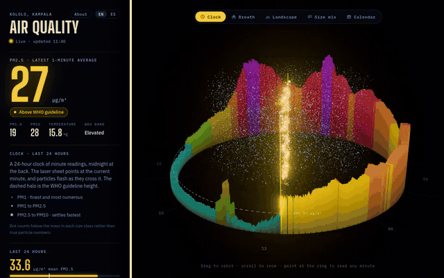

# Pollution

[](https://github.com/jonorl/pollution/actions/workflows/test.yml)
[](https://github.com/jonorl/pollution/actions/workflows/deploy-backend.yml)
[](https://github.com/jonorl/pollution/security/code-scanning)
[](https://pollution.jonathan-orlowski.dev/health)
[](https://github.com/jonorl/pollution/releases/tag/Android)
[](LICENSE)

A home-built air-quality monitor. A laser particle sensor in my office in Kololo, Kampala, Uganda, reports every minute to a small API, and a three.js dashboard draws the readings live, on the web and in an Android app.

**Live:** https://jonathan-orlowski.dev/pollution/ · **Android app:** [download the APK](https://github.com/jonorl/pollution/releases/download/Android/pollution.apk)



## How it fits together

```
PMS5003 + DHT22 ──► ESP32-S3 (Rust) ──HTTPS──► Fastify API ──► PostgreSQL
                     averages 1 min            (Docker, VPS)         │
                                                                     ▼
                     React + three.js dashboard ◄─┬─ polls every 30 s
                     (Cloudflare Pages)           │
                     React Native + three.js app ◄┘
                     (Android, Expo)
```

| Folder | What it is |
| --- | --- |
| [`firmware/`](firmware) | Rust firmware for the ESP32-S3: reads the sensors, averages, uploads |
| [`backend/`](backend) | Fastify + Prisma API that stores readings and serves them, raw and averaged |
| [`frontend/`](frontend) | React + three.js dashboard |
| [`mobile/`](mobile) | The dashboard as a React Native (Expo) Android app |

## Hardware

- **Plantower PMS5003** laser particle sensor: PM1.0, PM2.5 and PM10 in µg/m³, plus particle counts per 0.1 L at 0.3, 0.5, 1, 2.5, 5 and 10 µm
- **DHT22** (AM2302) digital temperature and humidity sensor, which replaced a TMP36 on 16 Oct 2026 after it started reading low and erratically
- **ESP32-S3** board (YD-ESP32-S3 N16R8); its RGB LED glows in the dashboard's colour for the current WHO band

| Part | ESP32-S3 pin |
| --- | --- |
| PMS5003 RXD | GPIO17 (UART1 TX) |
| PMS5003 TXD | GPIO18 (UART1 RX) |
| PMS5003 VCC / GND | 5 V / GND |
| DHT22 data | GPIO10 |
| DHT22 VCC / GND | 3.3 V / GND |
| RGB LED | GPIO48 (on the board) |

The PMS5003's fan needs a steady 5 V. Power the DHT22 from 3.3 V: its data line is pulled up to its supply, and the ESP32's pins don't tolerate 5 V.

## Firmware

Rust on ESP-IDF (`esp-idf-svc`). Every 5 seconds it reads a PMS5003 frame, dropping any that fail their checksum, and the DHT22's temperature and humidity, which it times bit by bit with interrupts briefly off. Every 12 readings it posts the one-minute average to the API over HTTPS, checking the server's certificate against ESP-IDF's bundle of root authorities. It reconnects to Wi-Fi if the link drops.

```sh
cd firmware
rustup override set esp        # once per clone; see below
cp cfg.toml.example cfg.toml   # Wi-Fi, API URL and key; gitignored
cargo run --release            # builds, flashes with espflash and opens the monitor
```

Needs the `esp` Rust toolchain ([espup](https://github.com/esp-rs/espup)), `ldproxy` and `espflash`. The toolchain is picked with `rustup override` rather than a `rust-toolchain.toml`, because Dependabot can't install `esp` and fails on that file.

## Backend

Fastify 5, Prisma 7 and PostgreSQL, with zod-validated routes.

| Route | Purpose |
| --- | --- |
| `POST /ingest` | One reading from the device; needs the `x-api-key` header |
| `GET /readings` | Raw minute readings, newest first; `since`, `limit`, `deviceId` |
| `GET /readings/bins` | Means per 1–60 minute bucket over up to 31 days |
| `GET /readings/daily` | Means per calendar day in a given time zone |
| `GET /health` | `200` with the deployed commit when Postgres answers, `503` when it doesn't |

The averaging is done in Postgres, so the dashboard downloads a few thousand rows rather than tens of thousands.

```sh
cd backend
cp .env.example .env
docker compose up -d           # local Postgres
npx prisma migrate deploy
npm run dev
```

**Deploying:** a push to `main` that touches `backend/` runs [`deploy-backend.yml`](.github/workflows/deploy-backend.yml). It runs the tests, builds the image, pushes it to `ghcr.io/jonorl/pollution-api` and restarts the container on the VPS, where Caddy serves it at `pollution.jonathan-orlowski.dev`. A smoke test then waits for `/health` to report the new commit and checks that `/ingest` still refuses requests without a key. The image's Docker `HEALTHCHECK` polls `/health` too. The service and its env vars live in my private infrastructure repo. Migrations aren't run by CI; after a deploy that adds one, run this on the VPS:

```sh
docker compose -f ~/my-VPS/projects/docker-compose.yml run --rm pollution-api npx prisma migrate deploy
```

## Frontend

React 19, Vite and three.js, in English and Argentine Spanish. Five views of the same data:

- **Clock**: the last 24 hours as a ring of minute readings around a particle chamber
- **Breath**: the particles in one breath of this air, drawn through a pair of lungs
- **Landscape**: 14 days of 5-minute means as terrain
- **Size mix**: the last 24 hours split by particle size
- **Calendar**: daily means for the last 26 weeks

PM2.5 is coloured by WHO's 2021 24-hour guideline (15 µg/m³) and its interim targets.

```sh
cd frontend
npm install
npm run dev                    # uses the live API; set VITE_API_URL for another
```

**Deploying:** Cloudflare Pages builds `frontend/` on every push to `main`, and a Worker serves it under `jonathan-orlowski.dev/pollution/`.

**Security headers:** [`frontend/public/_headers`](frontend/public/_headers) sets a Content-Security-Policy (scripts only from the site, Google Analytics and Cloudflare's analytics; no inline scripts; connections only to the API and analytics), `X-Frame-Options`, `Referrer-Policy` and `Permissions-Policy`. The CSP is in report-only mode while it's being verified.

## Mobile

The same dashboard as an Android app, in React Native and Expo. The five views run the web's three.js scenes through expo-gl, with touch gestures in place of the mouse and React Native drawing the labels. It stops polling while it's in the background.

**Download:** [`pollution.apk`](https://github.com/jonorl/pollution/releases/download/Android/pollution.apk) (35 MB), from the [Android release](https://github.com/jonorl/pollution/releases/tag/Android). Open it on the phone to install; it needs Android 7 or later and a 64-bit phone, and the phone asks once to allow installs from your browser.

```sh
cd mobile
npm install
npx expo start                 # press a for Android, or scan the QR code with Expo Go
```

Native builds need JDK 17 and the Android SDK, with `JAVA_HOME` and `ANDROID_HOME` set. The emulator draws GL in software, too slowly for the 3D views to judge, so test those on a phone: with USB debugging on, build a release APK and install it.

```sh
cd mobile
npx expo prebuild --platform android      # generates android/, which is gitignored
cd android
./gradlew assembleRelease -PreactNativeArchitectures=arm64-v8a
adb install -r app/build/outputs/apk/release/app-release.apk
```

Without the upload key that APK is signed with the debug key, so uninstall it before installing a release from GitHub.

**Releasing:** pushing a `mobile-v*` tag runs [`release-android.yml`](.github/workflows/release-android.yml), which builds a signed APK and attaches it to a GitHub release. [`mobile/README.md`](mobile/README.md) covers the signing key and local builds.

## Testing and CI

Each app has its own Jest suite:

| Folder | What's tested |
| --- | --- |
| `backend/` | Every route through Fastify's `inject`, with Prisma mocked: ingest auth and validation, query limits, `/health` and its cache |
| `frontend/` | WHO bands, breath counts and lung damage, locale formatting, the polling hook |
| `mobile/` | The app's copies of the bands and size classes against the web's and the firmware's LED colours, and its breath maths |

```sh
cd backend    # or frontend, mobile
npm test
npm run typecheck
```

[`test.yml`](.github/workflows/test.yml) runs the type check, lint and tests for all three on every push and pull request. `main` is protected: changes go through a pull request, and the three test jobs and CodeQL must pass. Dependabot opens grouped updates weekly for npm and monthly for the firmware's crates and the Actions. Nothing tests the firmware in CI, so flash a crate update to the board before merging it.

## Licence

Developed by [Jonathan Orlowski](https://jonathan-orlowski.dev/). Licensed under the Apache License 2.0, see [`LICENSE`](LICENSE).
